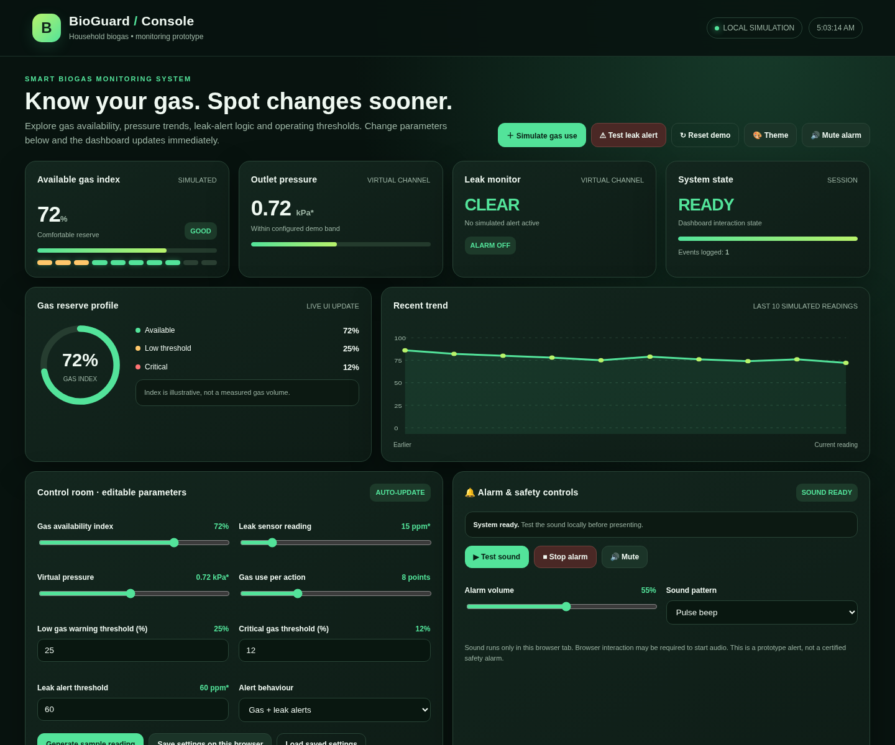
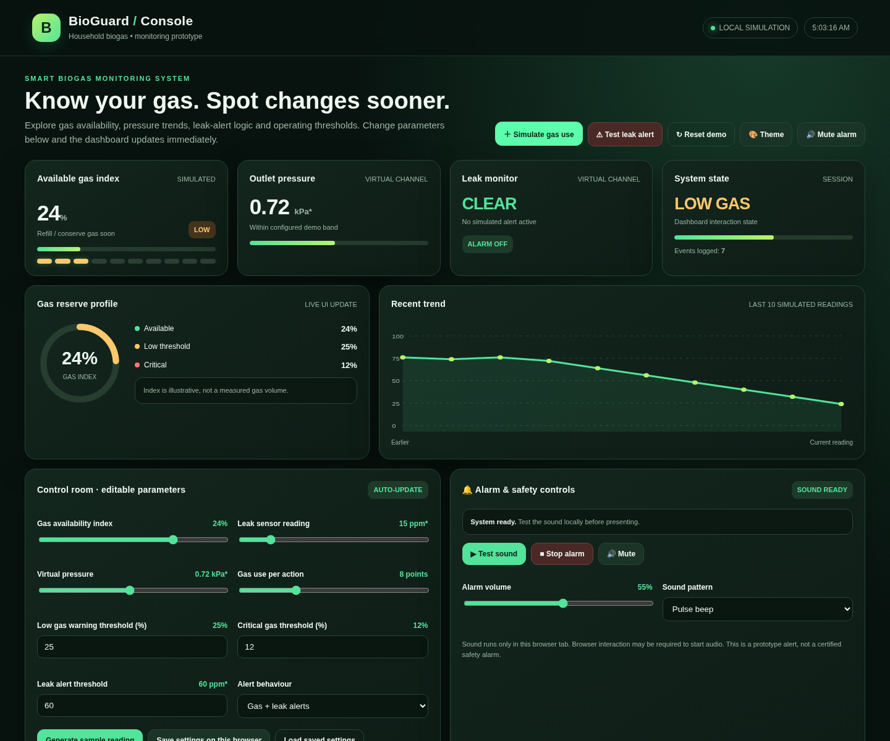
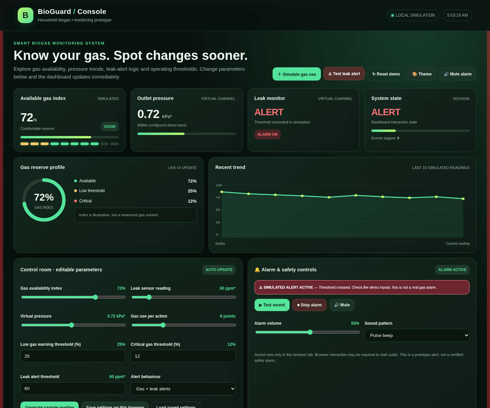

<div align="center">

# 🌱 BioGuard — Biogas Level & Leak Monitor

**Know your gas. Spot changes sooner.**

A browser-based simulation of a low-cost biogas level and leak monitor for household digesters — built as a Design Thinking project (Problem Statement 24).


*Noida Institute of Engineering & Technology, Greater Noida — CSE (AI), 3rd Year*

</div>

---

## 📖 Table of Contents

- [About the Project](#-about-the-project)
- [Problem Statement](#-problem-statement)
- [Screenshots](#-screenshots)
- [Key Features](#-key-features)
- [How It Works](#-how-it-works)
- [Design Thinking Methodology](#-design-thinking-methodology)
- [Proposed Hardware](#-proposed-hardware)
- [Tech Stack](#-tech-stack)
- [Getting Started](#-getting-started)
- [Project Structure](#-project-structure)
- [Testing & Results](#-testing--results)
- [Limitations (Honest Disclosure)](#-limitations-honest-disclosure)
- [Future Scope](#-future-scope)
- [Project Documentation](#-project-documentation)
- [Team](#-team)
- [References](#-references)

---

## 🌍 About the Project

Households that cook with small biogas digesters usually have **no simple way to see how much gas is stored**, and a slow leak at a pipe joint can go unnoticed until the cooking flame weakens. This wastes fuel, interrupts cooking and creates a safety risk.

**BioGuard** answers the design question:

> **How might we** give a household a simple, visible readout of how much biogas is available, and an early warning if gas is leaking?

The proposed physical system uses a low-pressure sensor at the digester outlet, an MQ-series combustible-gas sensor near the pipe joints, an ESP32/Arduino controller, an LED bar-graph and a buzzer. Since physical hardware was not available within the project timeline, the implemented deliverable is the **BioGuard Console** — a self-contained browser simulation (single HTML file, no build step, no server) that demonstrates the complete user interface, alert logic and scenario behaviour intended for the physical device.

> ⚠️ **This is a software simulation.** All readings are illustrative, generated locally in the browser. It is not a certified gas-safety device.

## 🎯 Problem Statement

| Item | Details |
|---|---|
| **Project ID** | 24 |
| **Title** | Low-Cost Biogas Level and Leak Monitor for Household Digesters |
| **Category** | Bioenergy / Environmental Biotechnology |
| **Target users** | Rural & semi-urban homes cooking with 1–6 m³ family biogas plants (India has **4.31 M** family-type plants — MNRE) |

## 📸 Screenshots

| Normal Operation (72% · GOOD · CLEAR) | Low-Gas Warning (24% · LOW) | Leak Alert (ALERT · ALARM ON) |
|---|---|---|
|  |  |  |

## ✨ Key Features

- 🎚️ **Gas availability index** — 10-segment LED bar-graph + SVG gauge with **GOOD / LOW / CRITICAL** states
- 📉 **Outlet pressure channel** — virtual pressure reading with demo operating band
- 🚨 **Leak monitor** — CLEAR / ALERT status with threshold-based logic
- 🔊 **Alarm engine** — Web Audio tones (pulse / rapid / steady), volume, mute; red edge-flash on alert
- 📊 **Trend chart** — last 10 simulated readings as an SVG area chart
- 🧾 **Event log** — 30-event session history with timestamps
- 🎛️ **Control room** — editable thresholds (low, critical, leak ppm) and gas-use rate; changes apply instantly
- 🔔 **Alert modes** — gas + leak, gas only, leak only, or quiet
- 💾 **Save settings** — persisted per-browser via localStorage
- 🎨 **4 themes** — forest green, ocean, violet, light

## ⚙️ How It Works

### Alert decision logic (demo defaults — all editable)

| Condition | State shown | Dashboard response |
|---|---|---|
| Gas index > 25% | `GOOD` | Green cue, comfortable reserve |
| Gas index ≤ 25% | `LOW` | Amber cue — refill / conserve soon |
| Gas index ≤ 12% | `CRITICAL` | Red cue + alarm tone |
| Leak reading ≥ 60 ppm* | `ALERT` | Red banner, edge flash, buzzer |
| Level drops faster than normal | Mobile alert | Optional Wi-Fi (ESP32) notification |

### Signal flow

```
Digester gas outlet ──► Pressure sensor ──┐
                                          ├──► ESP32 / Arduino ──► LED bar-graph (gas level)
Pipe joints ──────────► MQ gas sensor ────┤         │  compares readings
                                          ┘         │  with thresholds
                                                    ├──► Buzzer (leak alarm)
                                                    └──► Mobile alert (fast level drop)
```

| Input | Sensor | Processor | Output |
|---|---|---|---|
| Digester gas outlet | Pressure sensor — stored-gas level | ESP32/Arduino vs. thresholds | LED bar-graph |
| Pipe joints | MQ gas sensor — leak detection | ESP32/Arduino vs. thresholds | Buzzer |
| — | — | ESP32/Arduino | Mobile alert |

## 🔄 Design Thinking Methodology

| Stage | What we did |
|---|---|
| **1. Empathize** | Households cannot see stored gas; slow leaks go unnoticed until the flame weakens |
| **2. Define** | Need a visible level readout and an early leak warning |
| **3. Ideate** | Pressure gauge, MQ sensor near joints, mobile alert, LED bar + buzzer (works without a smartphone) |
| **4. Prototype** | BioGuard Console — browser simulation of the full UI and alert logic |
| **5. Test** | Scenario testing: normal, low-gas, leak and reset states |

## 🔩 Proposed Hardware

- **Low-pressure sensor** — estimates stored gas at the digester outlet
- **MQ-series sensor (e.g. MQ-4)** — detects combustible gas near pipe joints
- **Arduino / ESP32** — reads sensors and decides against thresholds
- **LED bar-graph** — readable level display from the kitchen
- **Buzzer** — audible leak alarm
- **Wi-Fi (ESP32, optional)** — mobile notification on fast level drop

## 💻 Tech Stack

| Layer | Technology |
|---|---|
| UI | HTML5 + CSS3 (single self-contained file) |
| Logic | Vanilla JavaScript |
| Visuals | SVG gauge + SVG trend chart |
| Audio | Web Audio API (alarm tones) |
| Storage | localStorage (settings) |
| Build step / server | **None** — opens directly in a browser |

## 🚀 Getting Started

No installation, no dependencies, no build step.

```bash
git clone https://github.com/anjaneya151/BioGuard.git
cd BioGuard
```

Then simply **open `index.html`** in Chrome or Edge (double-click it, or right-click → Open With → browser).

**Try the demo in this order:**
1. **＋ Simulate gas use** — press repeatedly to watch the level fall into LOW / CRITICAL
2. **⚠ Test leak alert** — triggers the leak ALERT with banner flash and alarm tone
3. **↻ Reset demo** — restores default illustrative readings (72% · GOOD)
4. **🎨 Theme** — cycles the four colour themes
5. Adjust thresholds in the **Control room** — the dashboard reacts instantly

## 📁 Project Structure

```
BioGuard/
├── index.html                                   # BioGuard Console (complete app)
├── README.md
├── LICENSE
└── docs/
    ├── BioGuard_Design_Thinking_PPT.pdf         # Presentation deck (submitted)
    ├── BioGuard_Project_Report-1.pdf            # Full project report (submitted)
    ├── BioGuard_Premium_Presentation.pptx       # Editable presentation (10 slides)
    ├── BioGuard_Premium_Report.docx             # Editable report
    ├── BioGuard_Viva_Notes.txt                  # Viva preparation notes
    └── screenshots/                             # Captured console states
        ├── 01-normal-operation.png
        ├── 02-low-gas-warning.png
        └── 03-leak-alert.png
```

## 🧪 Testing & Results

Scenario tests were executed on the prototype; **all matched the expected behaviour**.

| # | Scenario | Action in dashboard | Observed output | Result |
|---|---|---|---|---|
| 1 | Normal use | Start state: 72% gas, 15 ppm* | GOOD · CLEAR · ALARM OFF · READY | ✅ Pass |
| 2 | Low gas | 6 × Simulate gas use (−8 each) | LOW · amber cue · system LOW GAS | ✅ Pass |
| 3 | Critical gas | Gas index reduced below 12% | CRITICAL · red cue + alarm tone | ✅ Pass |
| 4 | Possible leak | Test leak alert / leak at 62 ppm* | ALERT · ALARM ON · banner + tone | ✅ Pass |
| 5 | Reset | Reset demo | Back to 72% GOOD, defaults restored | ✅ Pass |

**Highlights:** 3 gas states demonstrated (GOOD · LOW · CRITICAL), 12 scenario checks in the full report, alert logic verified for all four alert modes.

## 🙏 Limitations (Honest Disclosure)

- **Software simulation only** — no physical sensor, ESP32, LED bar or buzzer is connected
- **Illustrative values** — ppm* and kPa* units are not calibrated; the gas index is not a measured gas volume
- **Not a certified gas-safety device** — never use this page as a real gas-leak detector
- **No mobile or cloud alert yet** — alerts stay in the browser tab
- **Browser limits** — audio needs a click first; saved settings stay per browser

## 🔮 Future Scope

1. **Integrate** — pressure + MQ sensors with ESP32
2. **Calibrate** — pressure-to-level mapping and leak threshold against a real digester
3. **Connect** — LED bar, buzzer and mobile alert
4. **Validate** — safely, under supervision, in the field

## 📚 Project Documentation

- 📑 [Presentation deck (PDF)](docs/BioGuard_Design_Thinking_PPT.pdf)
- 📄 [Full project report (PDF)](docs/BioGuard_Project_Report-1.pdf)
- ✏️ [Editable presentation (.pptx)](docs/BioGuard_Premium_Presentation.pptx)
- ✏️ [Editable report (.docx)](docs/BioGuard_Premium_Report.docx)

## 👥 Team

| Name | Roll No. | Role |
|---|---|---|
| **Anjaneya Mallick** | 2401331520036 | Team Leader |
| **Anurag Singh** | 2401331520045 | Team Member |
| **Ayush Raj** | 2401331520060 | Team Member |

**Guide:** Ms. Barkha Bhardwaj, Assistant Professor, Dept. of CSE, NIET Greater Noida
**HOD:** Dr. Anand Kumar Gupta, HOD CSE-AI, NIET Greater Noida

## 🔗 References

1. Problem Statement 24 — Low-Cost Biogas Level and Leak Monitor for Household Digesters (Design Thinking problem-statement sheet)
2. Hanwei Electronics — MQ-4 semiconductor sensor datasheet (methane/natural gas), sparkfun.com/datasheets/Sensors/Biometric/MQ-4.pdf
3. MNRE FAQ — family-type biogas plants in India, mnre.gov.in/faq

---

<div align="center">

*Built with the Design Thinking process — Empathize · Define · Ideate · Prototype · Test*

⭐ Star this repo if you found it useful!

</div>
